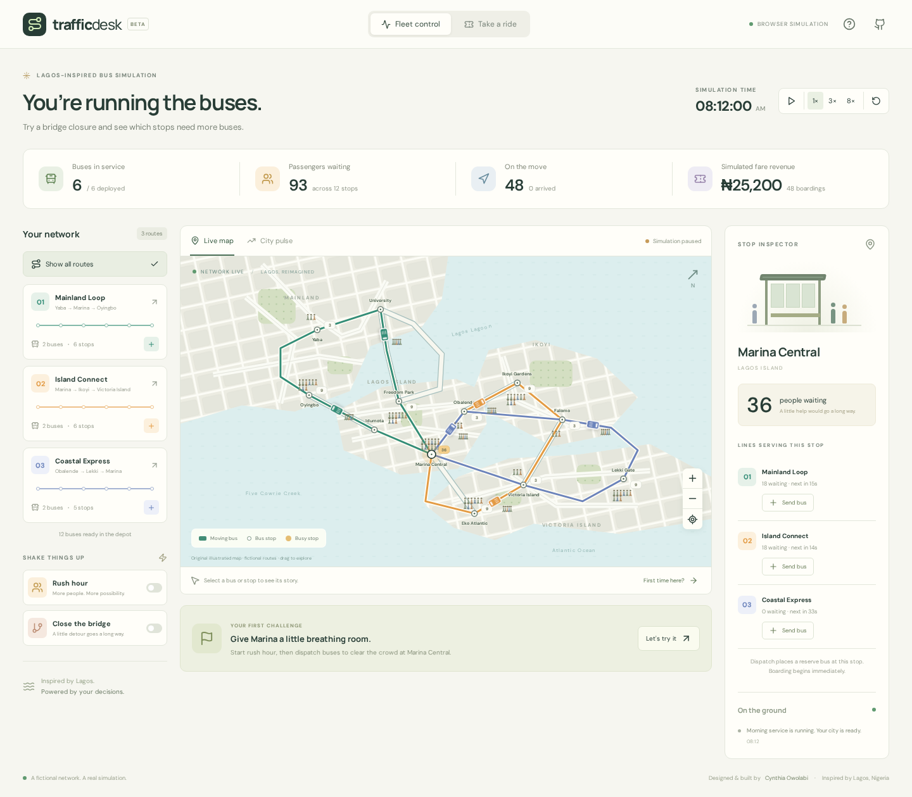

# TrafficDesk

**Keep the city moving.** A playable, Lagos-inspired transit operations simulation by Cynthia Owolabi.

Dispatch buses, watch passengers board, close a bridge, route around it, and take a ride through the same network you operate. Built around the urban transit, fare collection, ticketing and fleet tracking experience described in my CV; this project uses original fictional routes and synthetic demand.

[Play the interactive demo](https://adebolaowolabi32.github.io/trafficdesk/) · [Portfolio](https://adebolaowolabi32.github.io/)



## Run locally

Requires Node.js 22.13+ and npm.

```sh
npm ci
npm run dev
```

Open **http://localhost:5176/trafficdesk/**. On a remote VM, forward port 5176 over SSH or your editor's port forwarding before opening it in your browser. No API keys, databases or paid services are required.

For a production build:

```sh
npm run build
npm run preview
```

Open http://localhost:4176/trafficdesk/. Vite's base path is `/trafficdesk/`; change `base` in `vite.config.ts` for another hosting path.

## Try it

1. Start **Rush hour**. Select **Marina Central** and send buses on its three lines. Bring the queue below 20.
2. **Close the bridge**. Mainland buses already crossing finish their leg; later departures hold at University. Open the alternate route to resume departures via a longer path.
3. Select a bus, simulate a breakdown, then repair it. Its passengers remain aboard while it is stopped.
4. Switch to **Take a ride**. Get a demo ticket, join the queue, board a bus and follow it to your destination. Use 8× speed to travel faster.
5. Open **City pulse** to see live queue history and compare two seeded 120-second rush-hour runs: six buses versus nine.

The map supports dragging, zooming, and keyboard selection. Time pauses when the tab is hidden. Reduced-motion preferences start the simulation paused. Refresh or Reset city starts a fresh simulation; there is no saved personal data.

## How it works

- **React + TypeScript** control the application and inspectors; an original **SVG map** shows the network, vehicles and passenger figures.
- A deterministic simulation reducer handles demand, destination loads, capacity-limited boarding, fare totals, dispatch scheduling, incidents and tickets. No backend calls are involved.
- Three one-way loop routes serve 12 stops. Six buses begin service; the depot permits up to 18, with 32 seats each.
- A ticket is one passenger inside the real queue accounting. Boarding adds revenue once; arrival removes its passenger from the bus.
- Seeded demand makes experiments repeatable. The comparison uses isolated states so it does not disturb the user's city.

See [architecture and model boundaries](docs/ARCHITECTURE.md).

## Validation

```sh
npm test
npm run build
npx playwright install chromium
npm run test:e2e
npm run format:check
```

Tests cover passenger conservation, capacity, deterministic replay, closure/detour behavior, breakdown recovery, ticket journeys, dispatch limits and intervention outcomes. Browser tests cover operator controls, the full passenger journey, strategy comparison, desktop/mobile rendering, keyboard map selection, reduced motion and the absence of external data requests.

GitHub Actions runs CI and deploys the static demo to Pages through the manually triggered Deploy portfolio workflow. To verify the deployed demo, run `TRAFFICDESK_URL=https://adebolaowolabi32.github.io/trafficdesk/ npm run test:e2e`. The same four browser scenarios exercise the public site.

## Simulation boundaries

This is a transport operations sandbox, not a calibrated traffic model or navigation service. Geography, demand, fares and journey times are fictional. Vehicles have constant speed; there is no road congestion, vehicle collision avoidance, transfer planning, driver scheduling or real fare settlement. Reserve dispatch places a bus at a chosen stop immediately. Most generated passengers travel two stops; demo ticket passengers choose their destination. Figures illustrate a capped sample of each queue; the numeric badges give actual counts. Boarding and alighting figures animate the service event, while passenger accounting updates at arrival.

CV employer performance figures are not project benchmarks. No employer code or private data is included.

## Author

[Cynthia Owolabi](https://github.com/adebolaowolabi32), Senior Full Stack Engineer with experience across backend, frontend, platforms and applied AI.

[Portfolio and experience](https://adebolaowolabi32.github.io/) · [Current CVs](https://adebolaowolabi32.github.io/resume.html)
